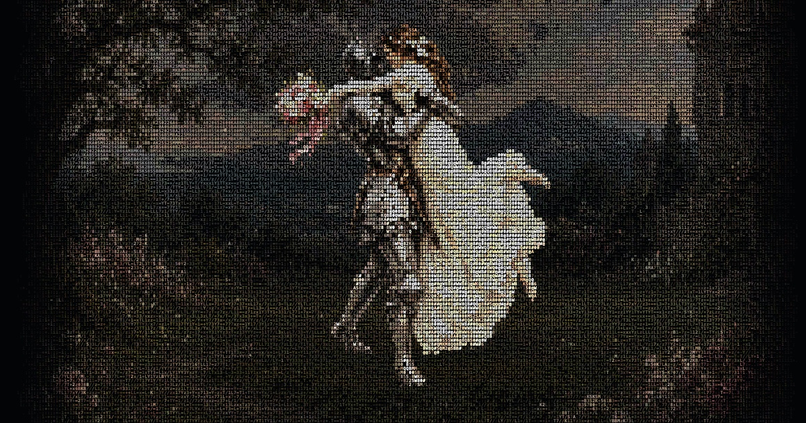

# Between Blinks

კამერა მებრძოლის ჩაფხუტის ჭრილში შედის და ადამიანის თვალზე გადადის. გუგაში ციხესიმაგრის ბაღი ჩანს, სადაც მებრძოლი თაიგულით ხელში მყოფ პრინცესას ეხუტება. კადრები და ფინალური შეტყობინება ასოებითა და ციფრებით არის დახატული.

## გახსნა

გახსენით [`index.html`](index.html) ან პირდაპირ [`ascii_eye_heart_cinematic.html`](ascii_eye_heart_cinematic.html) ბრაუზერში. პროექტს ბიბლიოთეკები და აწყობის ნაბიჯი არ სჭირდება. `index.html` ასევე მუშაობს GitHub Pages-ის საწყის გვერდად.

## გაზიარება

ცვლილებების `main` შტოში გაერთიანების შემდეგ GitHub-ზე ჩართეთ **Settings → Pages → Deploy from a branch → main → /(root)**. გამოქვეყნებული გვერდის მისამართი იქნება `https://sabazaqaidze31-glitch.github.io/sagas-rose/`.

## მართვა

- **პაუზა / გაგრძელება:** ეკრანზე არსებული ღილაკი ან `Space`.
- **თავიდან:** ღილაკი, თვალზე დაწკაპუნება ან `R`.

ანიმაცია ერგება ეკრანის ზომას. თუ სისტემაში მოძრაობის შემცირებაა ჩართული, საწყისი კადრი გაჩერებულია და ანიმაციის გაშვება ხელით შეიძლება.
